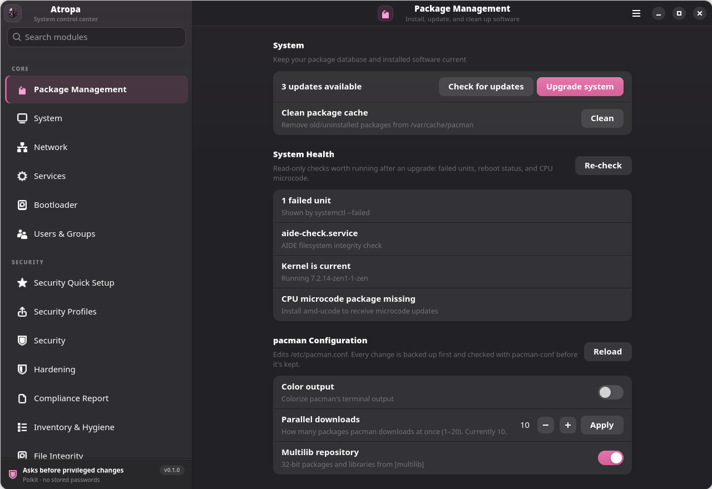
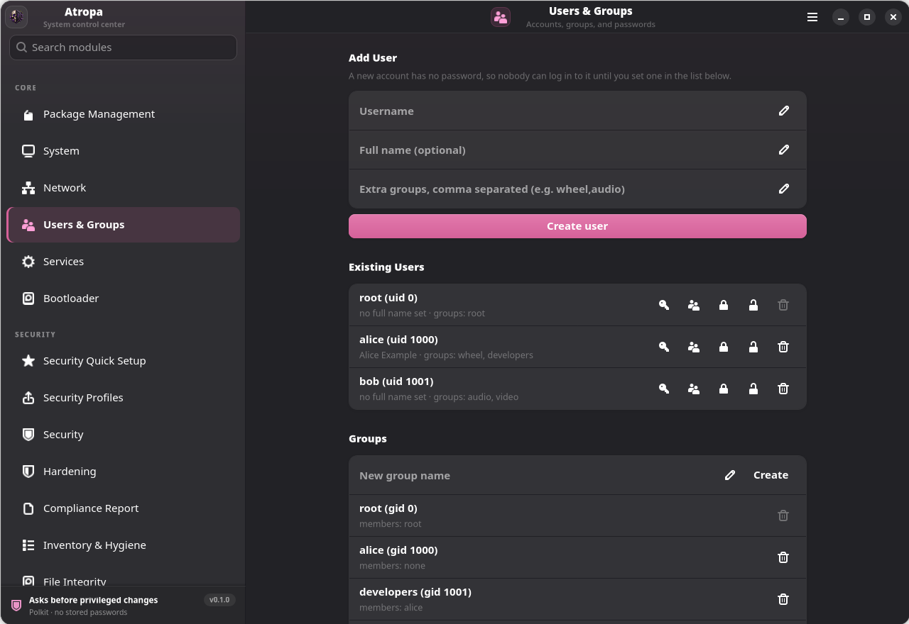
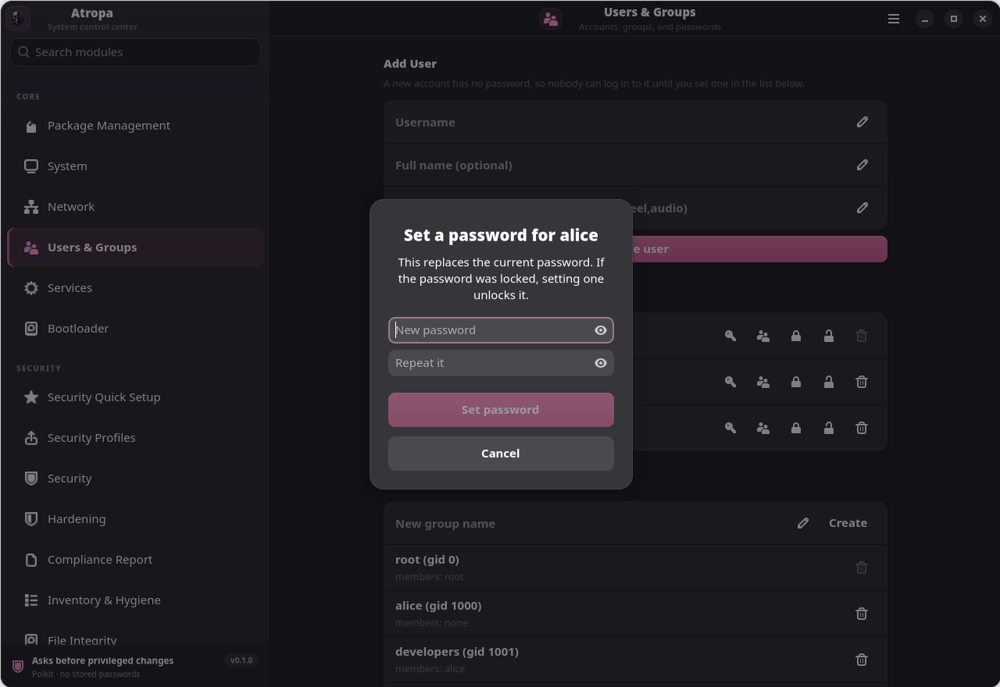
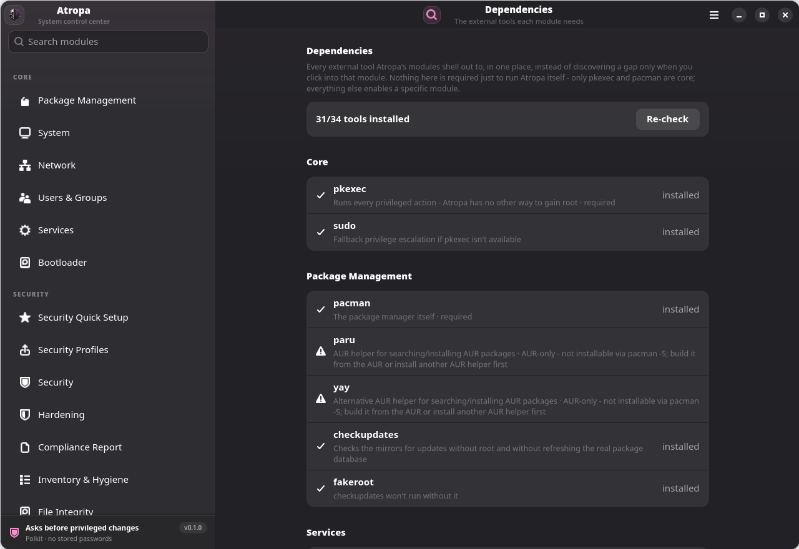

<p align="center">
  
</p>

# Atropa

A YaST-inspired system control center for Arch Linux, built with GTK4 and
libadwaita. Atropa runs as your normal user and asks for authentication
(via polkit/`pkexec`) only for the individual actions that need root.

> Developer/internals reference: see [`DOCUMENTATION.md`](DOCUMENTATION.md).

<p align="center">
  
  
</p>
<p align="center">
  
  
</p>

Atropa follows your desktop's light or dark style; these show the dark one.

The sidebar groups modules into **Core**, **Security** and **Maintenance**
(plus **Extensions** for enabled plugins),
with a search box that also matches feature words (try "firewall" or
"backup"). `Ctrl+K` / `Ctrl+F` focus search, `Esc` clears it, `F5` refreshes
the current page, and the header menu has both actions plus **About**.

## Features

Each sidebar entry is a module:

| Module | What it does |
|---|---|
| **Package Management** | Pending updates (checked without touching the package database), Arch-news check before upgrading, full system upgrade (live output), post-upgrade health checks (failed units, reboot, microcode), pacman.conf toggles (color, parallel downloads, multilib), search repo + AUR (via `paru`/`yay` if installed), install/remove, orphans, cache cleanup |
| **System** | Hostname, timezone/NTP, locale (incl. `locale.gen`), console keymap and X11 layout |
| **Network** | NetworkManager devices, Wi-Fi, static IP/DHCP (systemd-networkd is detected but read-only) |
| **Users & Groups** | Create/modify/delete users and groups, lock/unlock and set passwords |
| **Services** | systemd units: start/stop/restart/enable/disable, journal tail |
| **Bootloader** | GRUB / systemd-boot detection, entries, timeout, kernel parameters (AppArmor/SELinux LSM lists, hardening options) with a boot entry kept on the old parameters |
| **Kernels** | Installed kernels, a fallback kernel, headers for DKMS, boot entries, leftover module folders |
| **Security Quick Setup** | One-click recommended baseline (firewall, fail2ban, sysctl, faillock, AppArmor, auditd, USBGuard, SELinux permissive), as a checklist or a guided wizard. On a desktop with no SSH server it opens no ports, skips fail2ban, and shows a desktop baseline instead. Can also add the unsigned SELinux package repository, locked behind the administrator password |
| **Security Profiles** | Export this machine's security posture to JSON and import it elsewhere, per-section |
| **Security** | Firewall (ufw or firewalld), SSH hardening with validate-before-reload and automatic rollback, sudoers syntax check |
| **Hardening** | Kernel sysctl hardening, fail2ban, USBGuard, auditd + CIS audit rule sets, login lockout, password complexity (and wiring `pam_pwquality` in), `su` restricted to wheel, `arch-audit` vulnerability scan, security audit score |
| **Encryption & Secure Boot** | LUKS root detection, firmware Secure Boot state, sbctl key creation/enrollment/signing (behind confirmations) |
| **Compliance Report** | Posture report with an exposure summary (firewall, SSH, listening sockets, LUKS, Secure Boot) on top of the CIS-style categories, exportable as Markdown (not an official CIS assessment) |
| **Inventory & Hygiene** | Read-only scans for unneeded network services and account/file hygiene issues |
| **File Integrity** | AIDE baseline/check/timer management with changed-path reports saved between launches, config validation, and next-run times (AIDE itself is AUR-only; install it first) |
| **AppArmor** | Profile modes, capability/network rule toggles, denial review with rule suggestions |
| **SELinux** | Status, enforcing/permissive (lock-gated), relabel, `restorecon`, booleans |
| **SELinux: Modules** | Installed, pending and new policy modules, each checked by the module linter (dangerous rules need acknowledging before install); load or batch-import `.te` files |
| **SELinux: Denials** | Setup Mode; denials per program with the best next step (boolean, relabel, dontaudit, module) and its drafted module reviewed in place |
| **SELinux: Build Policy** | Build/install/activate a Reference Policy source tree (modular builds); fetches Atropa's own policy on request |
| **SELinux: Dev** | Experimental: drafts denials with the running policy's own interfaces and permission sets, proposes file labels from the program's package files, shows what the policy source already allows (or allows behind a boolean), lets you add paths no test run touched, and compiles the module against the source to check it; installs nothing |
| **Config Changes** | Review `.pacnew`/`.pacsave` files left by upgrades: diff, replace, or keep the current config |
| **Boot Report** | What went wrong since this boot: journal errors, failed units, recent crashes |
| **Disk Health** | SMART health (one-click root read where the kernel requires it), filesystem usage, `fstrim.timer`, journal/cache/coredump cleanup |
| **Snapshots** | Btrfs: sets up snapper + snap-pac (a snapshot before and after every pacman run), lists snapshots, shows what changed since one and restores single files, adds them to the GRUB menu with grub-btrfs. Explains what a whole-system rollback means on this layout |
| **Package History** | Recent pacman transactions from `pacman.log`; roll one back by reinstalling the versions it replaced from the package cache (asks every time). Clean keeps the previous version so this stays possible |
| **Firmware** | fwupd devices and updates, streamed |
| **Mirrors** | Rank Arch mirrors with `reflector` and replace the mirrorlist (backed up first) |
| **Power** | Power profiles, battery charge limits, lid/power-button/hibernate-delay settings, zram swap, hibernation feasibility |
| **Flatpak** | Installed apps, updates, unused-runtime cleanup |
| **Dependencies** | Which external tools each module needs, with install buttons for the ones `pacman` can install |
| **Add-ons** | Enable/disable declarative TOML plugins (see below) |
| **Activity & Backups** | Log of every privileged command, automatic config-file backups with restore, migration from old ArchYaST data |

Every config file Atropa edits is backed up first, by the root helper, to
`/var/lib/atropa/backups/` (root-owned, so nothing running as you can
change a backup before it's restored), and every privileged command is logged to
`~/.local/share/atropa/actions.log`. Commands are always invoked as an
argument list through `pkexec`/`sudo` - never through a shell - so a package
name, username or mirror URL cannot turn into a second command. The first
privileged action asks for the password; polkit then remembers it for its keep
window (five minutes by default), so a multi-step change asks once. Because
that authorization is cached, the helper does not run a generic shell or
`sed`: file writes are performed by the helper against an exact list of
paths Atropa manages, every other command is checked against the exact
arguments Atropa uses, and root-equivalent changes (passwords, users,
SELinux modules and mode, `pacman.conf`, `sshd_config`, kernel parameters,
PAM files) ask for the password every time. Changes that
can lock you out or end your session ask first and say what they affect:
stopping or restarting a service like the display manager or sshd, locking a
password, taking the last administrator out of `wheel`, turning the firewall
on, changing SSH logins.

## Requirements

- Arch Linux (or a derivative with `pacman`)
- Python ≥ 3.11
- `python-gobject`, `gtk4`, `libadwaita`, `polkit`
- Optional, per module: `networkmanager`, `ufw` or `firewalld`, `openssh`,
  `fail2ban`, `apparmor`, `usbguard`, `audit`, `arch-audit`, and
  `pacman-contrib` with `fakeroot` (to check for updates without touching
  the package database).
- Optional, from the AUR: `aide`, and SELinux's userspace tools
  (`policycoreutils`, `checkpolicy`, `semodule-utils`, `selinux-python`).
  The SELinux tools can also come from the
  [archlinuxhardened](https://github.com/archlinuxhardened/selinux) binary
  repository, which Security Quick Setup can add for you. That repository
  is unsigned, so pacman doesn't verify what it installs from it - which is
  why Atropa keeps it locked until you unlock it with the administrator
  password.
- Optional: `git` and `make`, to fetch and build
  [Atropa's SELinux policy](https://github.com/whitewhistlegit/refpolicy-atropa).

The **Dependencies** page shows what's missing.

## Install

```bash
git clone https://github.com/whitewhistlegit/atropa-GUI.git
cd atropa-GUI
./install.sh
```

`install.sh` will:

1. install system dependencies with `pacman` (needs `sudo`), plus the
   optional `arch-audit`, `pacman-contrib` and `fakeroot`;
2. install the privileged helper to `/usr/lib/atropa/atropa-helper` (and
   again as `atropa-helper-ask`) and its polkit actions to
   `/usr/share/polkit-1/actions/` - without these, Atropa
   still works but asks for the password on every privileged command;
3. install Atropa with `pipx install --system-site-packages --force .` so it
   gets its own venv but reuses the system PyGObject;
4. copy the desktop launcher and icons into the user's `.local` tree.

Then launch **Atropa** from your app menu, or run `atropa` (open a new
terminal first if `pipx ensurepath` just updated your `PATH`).

To uninstall: `pipx uninstall atropa`, then remove
`~/.local/share/applications/atropa.desktop`,
`~/.local/share/icons/hicolor/*/apps/org.atropa.Atropa.png`,
`/usr/share/polkit-1/actions/org.atropa.pkexec.policy`,
`/usr/lib/atropa/` (both helpers) and, if you don't want the backups,
`/var/lib/atropa/`.

### As a pacman package

[`packaging/arch/PKGBUILD`](packaging/arch/PKGBUILD) builds `atropa-git`
from the `main` branch, so pacman tracks every installed file and
`pacman -R atropa-git` removes them all. For a reproducible install of a
tagged release, [`packaging/arch/atropa/PKGBUILD`](packaging/arch/atropa/PKGBUILD)
builds the `0.3.0` tarball with a pinned checksum instead of the git head:

```bash
sudo pacman -S --needed base-devel python-build python-installer python-pytest
```

Then build either variant:

```bash
cd packaging/arch          # atropa-git, tracks main
makepkg -si
```

or:

```bash
cd packaging/arch/atropa   # atropa 0.3.0, pinned release tarball
makepkg -si
```

Run `makepkg -si` again to update (`makepkg -C -si` if your
`makepkg.conf` sets `BUILDDIR`: an old build folder there can make makepkg
quietly rebuild the previous version). Only pushed commits are packaged by the
`-git` variant, not local changes. If you used `install.sh` before, undo it first (see the
uninstall steps above): the pipx copy in `~/.local/bin` would shadow
`/usr/bin/atropa`, and pacman won't overwrite the polkit policy it copied.

### Run from source

```bash
sudo pacman -S python-gobject gtk4 libadwaita polkit
python3 -m atropa.main
```

## Plugins

Plugins are pure-data TOML manifests. They can only call actions that Atropa
explicitly exposes in `atropa/backend/plugin_registry.py`, and they can
never run arbitrary commands. Manifests live in
`/etc/atropa/plugins/<id>/manifest.toml`, which only root can write. You
enable them from the **Add-ons** page, which asks for authentication, and
the change takes effect on the next launch. See
[`examples/plugins/example-plugin/manifest.toml`](examples/plugins/example-plugin/manifest.toml)
for an annotated example.

## Development

The backend (`atropa/backend/`) has no GTK dependency, so you can lint and
test it anywhere:

```bash
pip install pytest ruff
python3 -m py_compile atropa/*.py atropa/ui/*.py atropa/ui/pages/*.py atropa/backend/*.py tests/*.py
ruff check .
python3 -m pytest -q
```

The suite is 1,678 tests across every backend module, the privileged
helper, Arch's stock config files and real SELinux drafts. It fakes the one
subprocess boundary (`privilege._subprocess_run`) rather than mocking each
module, so the code under test is the same code that runs on the machine.

CI (`.github/workflows/ci.yml`) runs the same three steps on Python 3.11 to
3.14, and builds every page under Xvfb (`xvfb-run -a python3 -m pytest
tests/test_ui_smoke.py`). How everything works is in
[`DOCUMENTATION.md`](DOCUMENTATION.md), what's open in [`TODO.md`](TODO.md),
and the project's history in [`docs/HISTORY.md`](docs/HISTORY.md).

## License

GPL-3.0-or-later — see [`LICENSE`](LICENSE).
